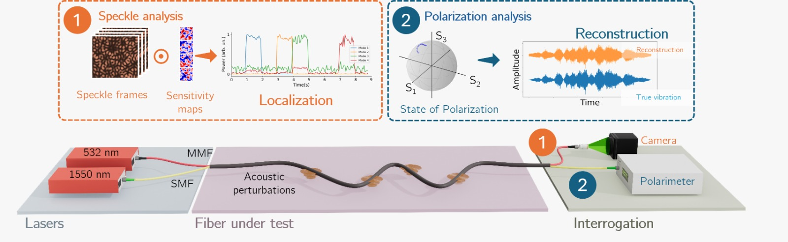

Researchers from QUANTOS have published a new approach for optical fiber vibration sensing that combines speckle dynamics and polarization interrogation within the same sensing architecture. The work, entitled “Multimodal speckle and polarization fiber sensing for localized, broadband vibration monitoring”, was published in [Scientific Reports](https://www.nature.com/articles/s41598-026-67432-x) in September.

Optical fibers are increasingly explored as sensing platforms for monitoring vibrations and acoustic signals, particularly in applications where measurements must be performed over extended distances or in environments where conventional electronic sensors may be difficult to deploy. However, distributed fiber sensing systems often involve a compromise between the spatial information that can be obtained and the bandwidth of the signals that can be reconstructed.

The proposed system addresses this challenge through a multimodal sensing strategy, where different properties of the light propagating through the fiber are used to extract complementary information. Dynamic changes in the optical speckle pattern are analyzed to determine the position at which a vibration is applied. In parallel, variations in the polarization state of the transmitted light are interrogated at high acquisition rates to reconstruct the temporal waveform associated with that vibration. In this way, localization and signal reconstruction are handled by two different optical observables rather than requiring a single interrogation technique to provide both.

<figure style="display: flex; flex-direction: column; align-items: center; margin: 2rem auto; text-align: center;">
  
  <figcaption style="font-style: italic; font-size: 0.9rem; color: #666; margin-top: 0.5rem;">Figure 1 - Schematics of the experimental scheme.</figcaption>
</figure>

The concept was experimentally demonstrated using four discrete sensing positions distributed along a four-meter optical fiber, under the assumption that a single position is active at a given time. Camera-based speckle measurements were used for localization, while polarization interrogation enabled the reconstruction of signals with frequencies between 100 Hz and 40 kHz. Measurements were performed at an acquisition rate of 200 kHz, with a reported signal-to-noise ratio of 35 dB.

Beyond the specific implementation, the work demonstrates the potential of combining different sensing modalities to overcome limitations associated with individual fiber interrogation techniques. The proposed architecture provides a framework in which spatial and temporal information can be obtained through complementary measurements, opening possibilities for further developments in multi-point acoustic and vibration sensing, including applications in condition monitoring, maintenance and surveillance.

