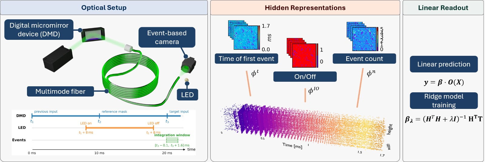

Our latest research, [Photonic extreme learning machines using event-based detection](https://doi.org/10.1364/OL.608461), has been accepted for publication in Optics Letters. The study explores how event-based cameras can provide alternative nonlinear responses for Photonic Extreme Learning Machines (PELMs), improving their ability to solve challenging classification tasks. Unlike conventional cameras, which record intensity frames, event-based cameras detect changes in light intensity independently at each pixel.

Building on our [previous theoretical framework](https://iopscience.iop.org/article/10.1088/1367-2630/ae51b5), this work investigates how changing the detection stage affects the computational capabilities of a photonic learning system. Input information is encoded onto an optical beam using a digital micromirror device and randomly mixed through propagation in a multimode fiber. An event-based camera then detects the resulting speckle pattern, generating representations that are processed by a trained digital linear readout.

## Key Highlights from the Study:

 - **Event-based detection as a nonlinear activation**: The camera’s thresholded response to logarithmic intensity changes provides an alternative to conventional intensity detection. This introduces new ways to transform optical signals into informative hidden representations for learning.

 - **Three representations from the same optical system**: We investigate the time of the first event, binary pixel activation, and total event count. Each representation captures a different aspect of the detector response, allowing us to explore how event timing and activity influence computational performance.

 - **Improved classification performance**: On the nonlinear two-spiral benchmark, the event-count representation achieves an accuracy of 93 ± 3%, compared with 78% reported for our previous intensity-based configuration on a similar benchmark. Comparable performance with regularized and unregularized readouts provides evidence of informative hidden representations whose effective dimensionality reaches the training-sample limit.

 - **Stability requirements for future implementations**: Regression experiments reveal sensitivity to systematic changes in the hidden representation between repeated measurements. These findings identify optical power stabilization and calibration as important directions for improving the reliability of event-based photonic computing.

Overall, this work demonstrates how event-based detection can expand the available nonlinear readouts for photonic learning systems. By connecting detector response, hidden representations, and task performance, the study advances the development of optical neuromorphic computing while identifying practical challenges for future implementations.

<figure style="display: flex; flex-direction: column; align-items: center; margin: 2rem auto; text-align: center;">
  
  <figcaption style="font-style: italic; font-size: 0.9rem; color: #666; margin-top: 0.5rem;">Figure 1 - Overview of the event-based photonic extreme learning machine. Input information is encoded using a digital micromirror device and randomly mixed through a multimode fiber. An event-based camera detects the resulting speckle pattern, which is converted into first-event timing, binary activation, or event-count representations before a digital linear readout produces the prediction..</figcaption>
</figure>

