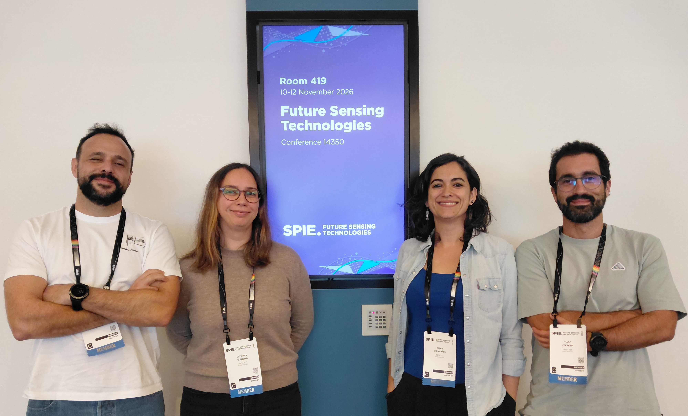
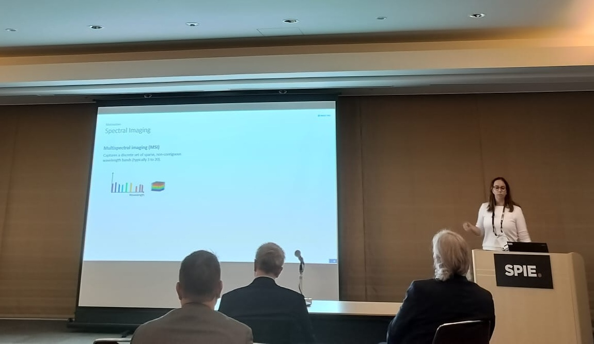
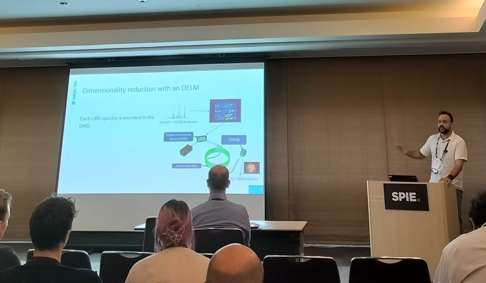
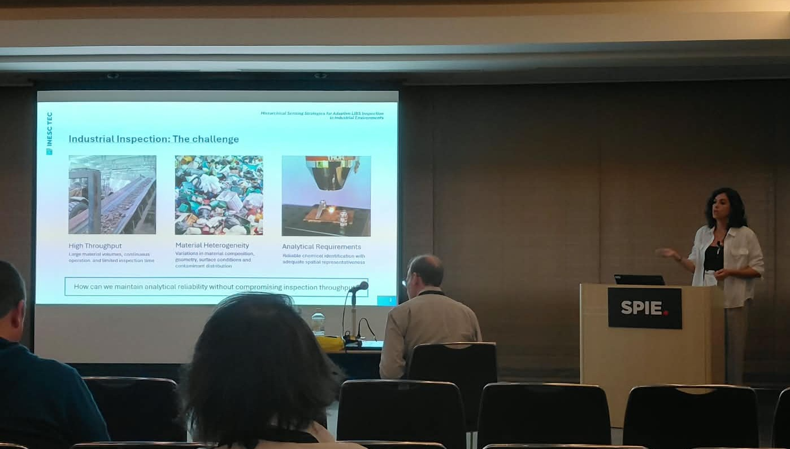
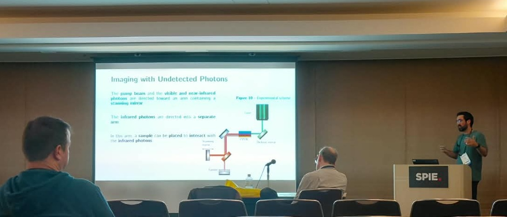
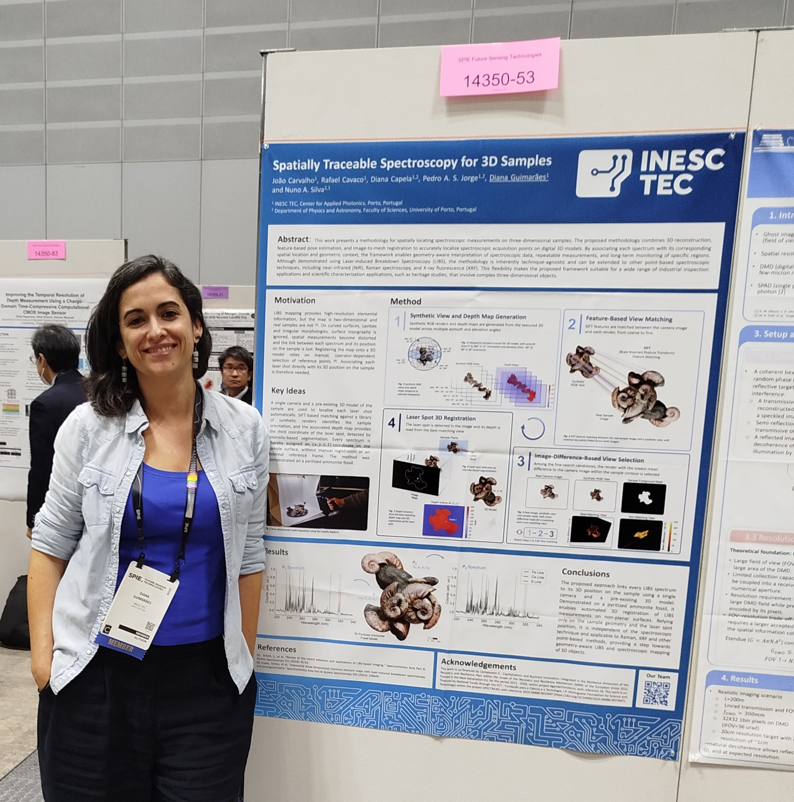
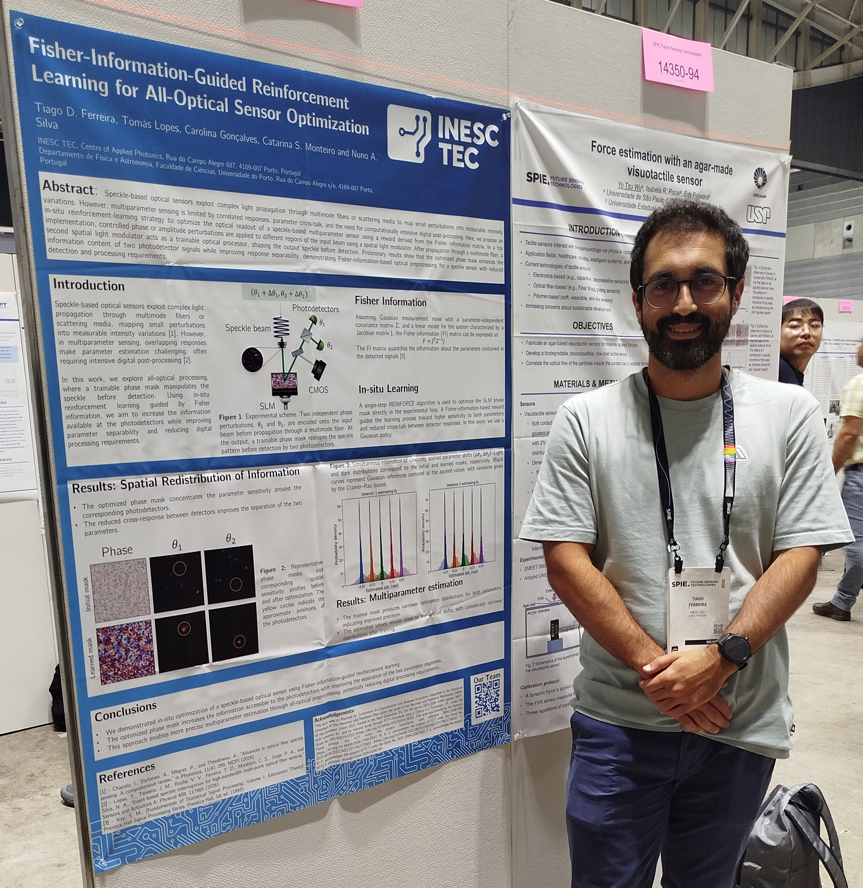
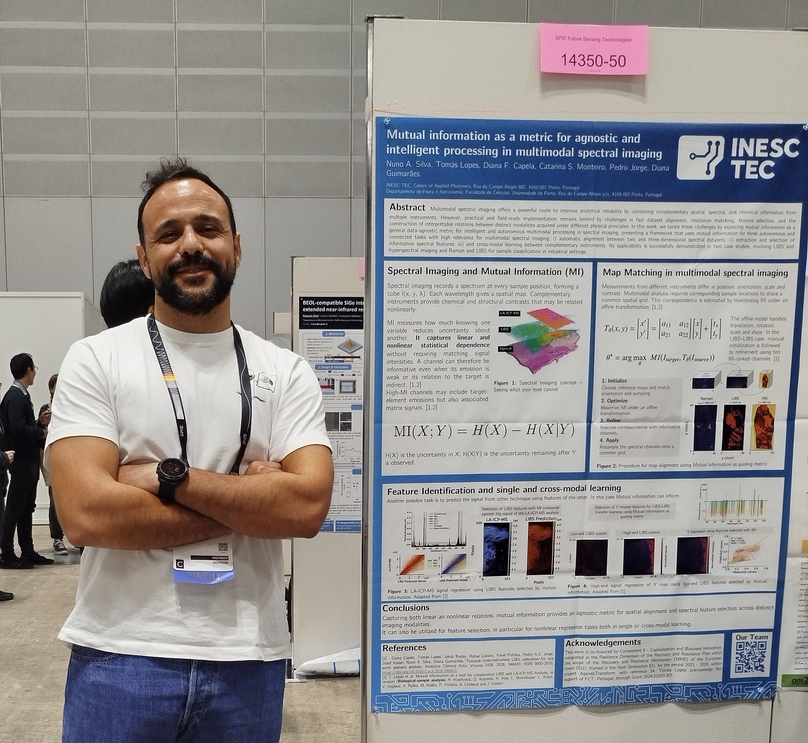

From 9 to 12 November 2026, members of the QUANTOS research team participated in SPIE Future Sensing Technologies 2026, held in Yokohama, Japan. The conference brought together researchers and industry professionals to discuss recent advances in optical sensing, imaging, and related technologies.

The team contributed with four oral presentations and three poster presentations, covering different research areas, including spectral imaging, optical computing, quantum imaging, and intelligent sensing strategies.

<figure style="display: flex; flex-direction: column; align-items: center; margin: 2rem auto; text-align: center;">
  
  <figcaption style="font-style: italic; font-size: 0.9rem; color: #666; margin-top: 0.5rem;">Figure 1 - Team photo at SPIE Future Sensing Technologies 2026.</figcaption>
</figure>

# Oral Presentations

### Event-based spectral imaging through spatial and temporal spectral encoding 

This work explored two event-based multispectral imaging architectures combining event cameras with spatial and temporal spectral encoding. The proposed approaches demonstrate the potential for high-speed, data-efficient spectral imaging, with applications ranging from microfluidic analysis to wavelength-selective imaging.

<figure style="display: flex; flex-direction: column; align-items: center; margin: 2rem auto; text-align: center;">
  
  <figcaption style="font-style: italic; font-size: 0.9rem; color: #666; margin-top: 0.5rem;">Figure 2 - Catarina Monteiro oral presentation.</figcaption>
</figure>

### Applications of optical extreme-learning machines in sensing: from fiber-sensor interrogation to dimensionality reduction in spectral imaging

This work investigated the application of optical extreme-learning machines in two sensing scenarios: speckle-based fiber-sensor interrogation and dimensionality reduction in spectral imaging. The results demonstrate the potential of optical computing to achieve performance comparable to conventional digital approaches while enabling substantially higher processing throughputs and reduced power consumption.

<figure style="display: flex; flex-direction: column; align-items: center; margin: 2rem auto; text-align: center;">
  
  <figcaption style="font-style: italic; font-size: 0.9rem; color: #666; margin-top: 0.5rem;">Figure 3 - Nuno Silva oral presentation.</figcaption>
</figure>

### Hierarchical sensing strategies for adaptive LIBS inspection in industrial environments

This work proposed a hierarchical sensing framework combining machine vision, spectral imaging, and Laser-Induced Breakdown Spectroscopy (LIBS) for adaptive industrial inspection. By integrating complementary sensing modalities, the approach aims to reduce redundant measurements, improve inspection efficiency, and support automated decision-making in industrial applications.

<figure style="display: flex; flex-direction: column; align-items: center; margin: 2rem auto; text-align: center;">
  
  <figcaption style="font-style: italic; font-size: 0.9rem; color: #666; margin-top: 0.5rem;">Figure 4 - Diana Guimarães oral presentation.</figcaption>
</figure>

### Polarization-sensitive quantum imaging: from Hong–Ou–Mandel microscopy to imaging with undetected photons

This work explored two complementary quantum imaging approaches for the characterization of birefringent materials. The first exploits Hong–Ou–Mandel interference for polarization-sensitive microscopy, while the second uses quantum imaging with undetected photons to investigate material properties at infrared wavelengths through the detection of visible or near-infrared photons.

<figure style="display: flex; flex-direction: column; align-items: center; margin: 2rem auto; text-align: center;">
  
  <figcaption style="font-style: italic; font-size: 0.9rem; color: #666; margin-top: 0.5rem;">Figure 5 - Tiago Ferreira oral presentation.</figcaption>
</figure>

# Poster Presentations

### Mutual information as a metric for agnostic and intelligent processing in multimodal spectral imaging

This work introduced a methodology combining 3D reconstruction, pose estimation, and spatial registration to accurately locate spectroscopic measurements on complex three-dimensional samples. The proposed framework enables measurement locations to be recovered across separate acquisition sessions, supporting repeatable and spatially traceable spectroscopic analysis.

<figure style="display: flex; flex-direction: column; align-items: center; margin: 2rem auto; text-align: center;">
  
  <figcaption style="font-style: italic; font-size: 0.9rem; color: #666; margin-top: 0.5rem;">Figure 6 - Diana Guimarães poster presentation.</figcaption>
</figure>

### Fisher-information-guided reinforcement learning for all-optical sensor optimization

This work investigated mutual information as a general metric for intelligent multimodal spectral imaging. The proposed framework supports automatic dataset alignment, spectral feature selection, and cross-modal learning, with applications demonstrated using complementary spectroscopic techniques, including LIBS, Raman spectroscopy, and hyperspectral imaging. <a href="../../posts/post_2026_11_17/SPIE_poster_Tiago_Fisher-Tiago.pdf" target="_blank" rel="noopener">Click here to see the poster. </a>

<figure style="display: flex; flex-direction: column; align-items: center; margin: 2rem auto; text-align: center;">
  
  <figcaption style="font-style: italic; font-size: 0.9rem; color: #666; margin-top: 0.5rem;">Figure 7 - Tiago Ferreira poster presentation.</figcaption>
</figure>

### Spatially traceable spectroscopy for 3D samples

This work proposed an in-situ reinforcement-learning strategy for optimizing the optical readout of speckle-based sensors using a Fisher-information-based reward. Preliminary results demonstrate improved information content and parameter separability through optical preprocessing, highlighting the potential for multiparameter sensing with reduced detection and computational requirements.

<figure style="display: flex; flex-direction: column; align-items: center; margin: 2rem auto; text-align: center;">
  
  <figcaption style="font-style: italic; font-size: 0.9rem; color: #666; margin-top: 0.5rem;">Figure 8 - Nuno Silva poster presentation.</figcaption>
</figure>

The participation in SPIE Future Sensing Technologies 2026 provided an opportunity to share ongoing research developed within QUANTOS, exchange ideas with the international scientific community, and explore new perspectives for the development of advanced optical sensing and imaging technologies.

## Acknowledgements

Diana Guimarães, Catarina Monteiro and Nuno Silva works were co-financed by Component 5 - Capitalization and Business Innovation, integrated in the Resilience Dimension of the Recovery and Resilience Plan within the scope of the Recovery and Resilience Mechanism (MRR) of the European Union (EU), framed in the Next Generation EU, for the period 2021 - 2026, within project AgendaTransform, with reference 34.

Tiago Ferreira work was financed by the National Funds through the FCT—Fundação para a Ciência e a Tecnologia, I.P. (Portuguese Foundation for Science and Technology) within the project HyperQuIm, with reference 2024.17596.PEX (https://doi.org/10.54499/2024.17596.PEX).

